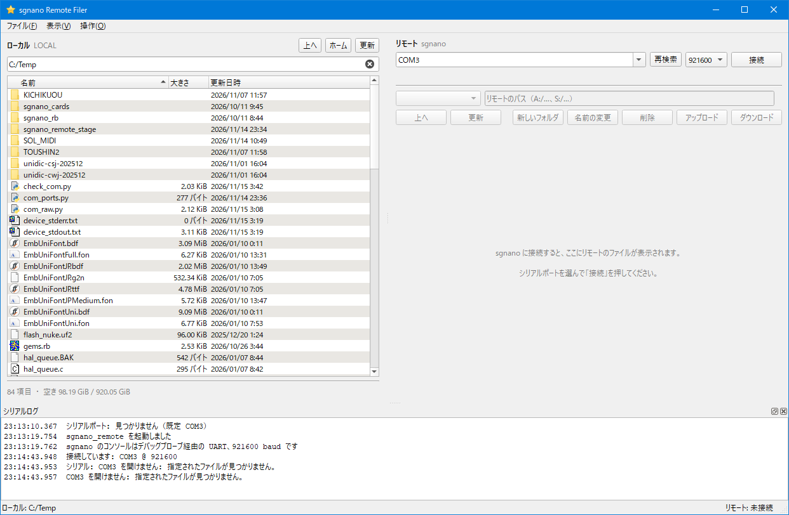

# sgnano_remote


**sgnano_remote** は、自作パソコン **sgnano** のファイルを PC から管理するためのデスクトップアプリです。

sgnano は、Raspberry Pi RP2350B を使った自作のビデオコンソールです。VGA 画面、USB キーボード・マウス、USB ストレージ、音源、ファイル管理などを備えています。
このアプリは、PC と sgnano を **UART（シリアルポート）** でつなぎ、PC 側のファイルと sgnano 側のファイルを 2 画面で並べて操作できるようにします。

- 左側: PC のファイル
- 右側: sgnano のファイル
- ファイルのアップロード・ダウンロード
- フォルダの作成・名前の変更・削除
- sgnano の中でのコピー・分割・結合
- 内蔵フラッシュ **S:** の検査・修復

Windows 10/11 x64 と Linux で動きます。Windows 用には、管理者権限が不要な per-user インストーラを用意しています。



*左が PC、右が sgnano のファイル一覧です。つないだあとは、右側に sgnano のファイルが並びます。*

---

## 特長

- **外部ツールが不要**
  - ファイル転送はアプリに内蔵した ZMODEM で行います。
  - `lrzsz`、Python、`scripts/zm.py` などの外部プログラムは使いません。
- **PC と sgnano の 2 画面**
  - ローカルのファイルを選んでアップロード
  - sgnano のファイルを選んでダウンロード
  - ドラッグ・アンド・ドロップにも対応
- **大きなファイル**
  - 4 MB を越えるダウンロードは、sgnano が送りながら機器から読むため、そのまま受け取れます。
  - 4 MB を越えるアップロードは、PC 側で自動的に分割して送り、sgnano 側で結合します。
- **sgnano の内蔵フラッシュ S: に対応**
  - S: は 4 MB の FAT12 です。
  - `SystemSettings`、`SystemFiles`、`SystemLogs` はシステムのフォルダで、削除・名前の変更はできません。
  - ルートの `bin`、`sbin` はシステムのフォルダではないため、このアプリでも保護しません。
  - S: の FAT12 を検査・修復できます。
- **リモート内のファイル操作**
  - sgnano の中でのコピー
  - `.001`、`.002` … の結合
  - 1 ファイルの分割
- **MIT ライセンス**
  - ソースコードは MIT ライセンスです。

---

## 必要なもの

### sgnano 側

- sgnano 本体（RP2350B ボード）
- 遠隔コマンドに対応したファームウェア
- PC とつなぐための UART
  - Raspberry Pi Debug Probe などの USB シリアル変換
  - ボーレートは既定で **921600**
- sgnano が **ファイラー画面**（ファイル一覧）を表示していること
  - Doom や Ruby などのプログラムが動いている間は、遠隔コマンドを受け付けないことがあります。

### PC 側

- Windows 10/11 x64
  - USB シリアルの COM ポートが見えること
- または Linux
  - Qt 6.2 以降
  - `/dev/ttyACM0` などのシリアルポート

---

## インストール

### Windows

配布されている `sgnano_remote_setup_*.exe` を実行してください。

- **per-user インストール**です。管理者権限は不要です。
- インストール先の既定:
  ```
  %LOCALAPPDATA%\Programs\sgnano_remote
  ```
- スタートメニューとデスクトップにショートカットを作ります。
- アンインストールは、スタートメニューの「アンインストール」か、Windows の「アプリと機能」から行えます。

> **注意**
>
> 現在のインストーラはコード署名をしていません。Windows SmartScreen で
> 「Windows によって PC が保護されました」と表示されることがあります。
> 内容を確認したうえで「詳細情報」→「実行」を選んでください。

### Linux

下の「ビルド」からソースコードでビルドしてください。

---

## 使い方

### 1. 接続する

1. sgnano をファイラー画面にします。
2. PC と sgnano を UART でつなぎます。
3. アプリを起動します。
4. シリアルポートを選びます。
   - Linux: `/dev/ttyACM0` など
   - Windows: `COM3`、`COM24` など
5. ボーレートを **921600** にします（sgnano の既定）。
6. 「接続」を押します。

接続すると、sgnano のドライブ一覧と、現在のフォルダの一覧を読み込みます。

### 2. 画面の見方

全体のようすは、上の画面写真を参照してください。

- 左側: PC のファイル
- 右側: sgnano のファイル
- 右側の上:
  - ドライブの選択
  - 現在のパス
  - 受信したバイト数
- 「上へ」「更新」でフォルダを移動・再読み込み
- 「新しいフォルダ」「名前の変更」「削除」でファイル操作
- 「アップロード」「ダウンロード」でファイル転送

### 3. アップロード

1. 左側でファイルを選びます（複数選択できます）。
2. 「アップロード」を押すか、右側のフォルダへドラッグ・アンド・ドロップします。
3. 同名のファイルは上書きされます。確認のうえ実行してください。

4 MB を越えるファイルは、自動的に分割して送られます。ユーザーが自分で分割する必要はありません。

### 4. ダウンロード

1. 右側でファイルを選びます。
2. 「ダウンロード」を押すか、左側のフォルダへドラッグ・アンド・ドロップします。
3. 同名のファイルは上書きされます。

一度にダウンロードできるのは 1 ファイルです。

### 5. フォルダ・ファイルの操作

右側の一覧で右クリックすると、次のメニューが出ます。

- 新しいフォルダ
- 名前の変更（F2）
- 削除（Delete）
- コピー（リモート内）
- 貼り付け
- 結合（.001）
- 分割（4 MB ずつ）
- S: を検査 / 修復（S: を開いているとき）
- 更新

削除は確認のうえ実行します。フォルダは空のときだけ削除できます。
たくさんのファイルを削除するときは、8 件ずつ順番に送ります。

### 6. リモート内のコピー

1. 右側でファイルを 1 つ選びます。
2. 右クリック →「コピー（リモート内）」
3. 移動先のフォルダを開きます。
4. 右クリック →「貼り付け」

sgnano の中だけでコピーするため、PC への転送は発生しません。

### 7. 分割と結合

sgnano の中にあるファイルを分割・結合できます。

- **結合**: `name.001` を選び、右クリック →「結合（.001）」
  - `.002`、`.003` … を順につないで `name` を作ります。
- **分割**: ファイルを選び、右クリック →「分割（4 MB ずつ）」
  - `name.001`、`name.002` … を作ります。

どちらも同じフォルダの中で行い、同名のファイルは置き換えます。

### 8. S: の検査と修復

S: を開いているときに右クリックすると、次の項目が出ます。

- **S: を検査**
  - FAT12 のファイル・フォルダの数、壊れた鎖などを調べます。
  - 中身は変更しません。
- **S: を修復**
  - ファイルの大きさ、余分な鎖、未接続のクラスタ、FAT2 などを直します。
  - 実行前に確認のダイアログが出ます。

---

## 大きいファイルについて

sgnano の ZMODEM は、一度に受け取れるファイルが **4 MB** までです。
このアプリは、その制限を意識せずに使えるように次の処理をします。

### ダウンロード

4 MB を越えるファイルは、sgnano が送りながら機器から読みます。
そのため、PC 側で特別な分割は不要です。

### アップロード

4 MB を越えるファイルは、PC 側で次のように分割します。

- 64 MB 以下: 1 MB ずつ
- 64 MB 超: 2 MB ずつ

分割したファイルを ZMODEM で送り、sgnano の `JOIN` で結合したあと、分割ファイルを削除します。
分割サイズは環境変数 `SGNANO_ZM_PART` で変更できます（512 の倍数）。

### 制限

- sgnano の `JOIN` は **64 個**までです。
- 64 MB を越えるファイルは、2 MB ずつにしても sgnano 側のメモリ不足や制限で失敗することがあります。
- 現在、**500 MB 程度の単一ファイル**をこの経路で送ることはできません。
- 大きなファイルを確実に移したい場合は、USB メモリ／USB-HDD にコピーして sgnano に接続する方法をおすすめします。
  - sgnano は FAT / exFAT / NTFS の USB ストレージを読めます。

---

## 制限と注意

- Windows インストーラは未署名です。SmartScreen の警告が出ます。
- ZMODEM の 1 ファイルの上限は 4 MB です。
- sgnano の `JOIN` は 64 個までです。
- 同一 exFAT 内の 4 MB 級のコピーは、sgnano 本体側の `read error` で失敗することがあります。
- sgnano のプログラム（Doom・Ruby・Python など）が動いている間は、遠隔コマンドが拒否されることがあります。ファイラー画面に戻ってから操作してください。
- ファイル操作中は、一覧の移動・更新・パス入力を一時的に受け付けません。
- 通信が止まったときは、いったん切断して接続し直してください。
- NTFS への対応は実装していますが、手元の実機に NTFS 区画が無いため、NTFS での実機試験は未実施です。

### 主なショートカット

| キー | 動作 |
|---|---|
| `F5` | リモートの一覧を更新 |
| `Ctrl+R` | ローカルの一覧を更新 |
| `Alt+Up` | リモートで親フォルダへ |
| `Ctrl+U` | アップロード |
| `Ctrl+D` | ダウンロード |
| `F2` | 名前の変更 |
| `Delete` | 削除 |
| `Ctrl+Shift+C` | 接続 / 切断 |
| `Ctrl+Shift+L` | シリアルログの表示切り替え |

---

## ビルド

### Linux

必要なもの:

```bash
sudo apt install build-essential cmake ninja-build qt6-base-dev
```

ビルド:

```bash
cmake -B build -G Ninja -DCMAKE_BUILD_TYPE=Release
cmake --build build
```

起動:

```bash
./build/sgnano_remote
```

設定は `~/.config/sgnano/sgnano_remote.conf` に保存されます。

### Windows（Windows 上でビルドする場合）

必要なもの:

- Qt 6.2 以降（MinGW または MSVC）
- CMake
- Ninja
- NSIS（`makensis.exe`）
- Qt の `windeployqt.exe`

PowerShell から:

```powershell
powershell -ExecutionPolicy Bypass -File packaging\windows\build-windows.ps1 `
    -QtDir C:\Qt\6.2.4\mingw_64 `
    -MinGWPath C:\Qt\Tools\mingw1120_64\bin
```

完成物:

```
build-windows\sgnano_remote_setup_0.1.0.exe
```

### Windows（WSL からクロスビルドする場合）

WSL に MinGW と NSIS を入れます。

```bash
sudo apt install g++-mingw-w64-x86-64 nsis
```

Qt の Windows 版と、Linux 側の Qt ホストツールを用意して実行します。

```bash
QT_DIR=~/Qt/6.2.4/mingw_64 packaging/windows/build-wsl.sh
```

- Qt 6.2.4 の Windows DLL は GCC 11.2 でビルドされています。
- アプリ側の `libstdc++` / `libgcc` は静的に結ぶため、Ubuntu の MinGW（GCC 10）でも起動できます。
- `MINGW_BIN` を指定すると、別の MinGW を使えます。

### アイコン

アイコンの元画像と Windows 用 `.ico` は `resources/icons/` にあります。
作り直す場合:

```bash
python3 packaging/icons/make_icon.py
```

Pillow が必要です。

---

## 試し

実機がなくても、プロトコルと ZMODEM の試しを実行できます。

```bash
ctest --test-dir build --output-on-failure
```

- `sgnano_remote_selftest`
  - 遠隔コマンドの送信・応答
  - S: のシステムフォルダの見分け
  - 削除待ち行列
- `sgnano_remote_zmodem_selftest`
  - ZMODEM の送受信（Linux のみ）
- `sgnano_remote_uploadsplit_selftest`
  - 4 MB 超のファイルの分割

### 実機の試し

```bash
# Linux
./build/sgnano_remote_selftest --device /dev/ttyACM0

# Windows（例）
build-windows\sgnano_remote_selftest.exe --device COM24
```

`--device` は、sgnano の exFAT / NTFS の区画に `!qt_selftest` などのテスト用フォルダを作り、終わったら削除します。
S: は読み取りだけを確認します。

大きいファイルの試し:

```bash
./build/sgnano_remote_selftest --device-large /dev/ttyACM0
```

- 4 MB + 123 バイトのアップロード
- 分割 → ZMODEM → JOIN
- ダウンロードと中身の比較
- COPY / SPLIT / JOIN

多数の削除の試し:

```bash
./build/sgnano_remote_selftest --device-many /dev/ttyACM0
```

> 実機の試しは、テスト用のフォルダを作成・削除します。
> 大切なデータがあるドライブでは実行しないでください。

---

## 仕組み

このアプリは、sgnano の UART 遠隔コマンドを使います。

- コマンドは `0x1E` で始まる 1 行
- 応答は `@SG` で始まる行
- 主なコマンド:
  - `PING`、`CWD`、`DRIVES`
  - `LIST`、`STAT`
  - `MKDIR`、`REN`、`DEL`
  - `COPY`、`SPLIT`、`JOIN`
  - `SYSFSCK`
  - `ZPUT`、`ZGET`
- ファイル転送:
  - `src/zmodem.cpp` の内蔵 ZMODEM
  - 4 MB 超のアップロードは `src/uploadsplit.cpp` で分割
- Windows のシリアル:
  - `src/win32serial.cpp`
  - 通常の遠隔コマンドは QTimer で読み取り
  - ZMODEM は専用スレッドで読み書き

主なファイル:

| ファイル | 役割 |
|---|---|
| `src/mainwindow.cpp` | アプリ全体、メニュー、転送の進行 |
| `src/localpane.cpp` | PC 側の一覧 |
| `src/remotepane.cpp` | sgnano 側の一覧と操作 |
| `src/remoteprotocol.cpp` | 遠隔コマンドの送受信 |
| `src/zmodem.cpp` | 内蔵 ZMODEM |
| `src/zmodemworker.cpp` | 転送スレッド |
| `src/uploadsplit.cpp` | 4 MB 超の分割 |
| `src/win32serial.cpp` | Windows の COM ポート |

---

## 困ったとき

### シリアルポートが見つからない

- Linux:
  ```bash
  ls /dev/ttyACM* /dev/ttyUSB*
  ```
  `dialout` グループに入っているか確認してください。
  ```bash
  sudo usermod -aG dialout "$USER"
  ```
  反映にはログインし直しが必要です。
- Windows:
  - デバイスマネージャーで COM ポートを確認
  - USB シリアルのドライバーが入っているか確認
  - アプリのポート欄には `COM3` のように入力できます

### 接続しても一覧が出ない

- sgnano がファイラー画面か確認してください
- Doom・Ruby・Python などのプログラムが動いていないか確認してください
- ボーレートが 921600 か確認してください
- いったん切断して接続し直してください

### 転送が始まらない・止まった

- sgnano 側に ZMODEM の状態が残っている可能性があります
- アプリで切断 → 接続し直すと、残留状態を取り消します
- それでもだめなら、sgnano を再起動してください

### 大きなファイルが送れない

- 4 MB を越えるファイルは自動分割されます
- 64 MB を越えるファイルは制限があります
- 500 MB 級は USB ストレージを使ってください

### SmartScreen の警告が出る

- インストーラが未署名のためです
- 「詳細情報」→「実行」で進めます
- 配布時にコード署名を追加することもできます

---

## ライセンス

MIT License です。詳しくは [`LICENSE`](LICENSE) を読んでください。
